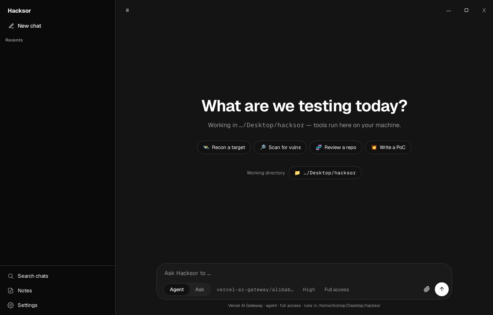

# Hacksor

[](https://github.com/louislafosse/hacksor/actions/workflows/ci.yml)
[](https://github.com/louislafosse/hacksor/actions/workflows/release.yml)

Hacksor is a local-first AI penetration-testing assistant: one desktop app (Tauri,
Rust backend plus web UI) that drives the **Codex agent harness** on your machine and
gives it a full Kali toolset inside a bundled Docker runtime. No cloud backend, no
account, no telemetry — the only thing that leaves your machine is the model API call
to the provider you choose.

It began as a fork of HackerAI with all the hosted infrastructure removed (Convex,
Trigger.dev, E2B, WorkOS, Stripe) and replaced by one process you run locally.

<p align="center">
  
</p>

> **Authorized use only.** Hacksor is for security testing you are authorized to
> perform (your own systems, an explicit engagement scope, a lab, or a bug-bounty
> program). You are responsible for staying in scope and within the law.

## Contents

[Features](#features) · [Requirements](#requirements) · [Install](#install) ·
[First run](#first-run) · [How it works](#how-it-works) · [Runtime modes](#runtime-modes) ·
[Bundled toolkit](#bundled-toolkit) · [Build from source](#build-from-source) ·
[Releases](#releases) · [Layout](#layout)

## Features

**Chat and agent loop**
- **Ask mode** (read-only advice) and **Agent mode** (executes end to end).
- **Permission modes:** full access, ask-approval, auto-review (a reviewer model
  judges each gated action), read-only.
- Streaming markdown with syntax highlighting, Mermaid, KaTeX, command cards,
  diffs, plan/todo and a tool-output drawer.
- Multi-thread history with full-text search, pinned chats, edit-and-resend, a
  message queue, Recents/Archive, custom instructions, personality presets, and
  automatic context compaction so long engagements keep going.
- Attach files with the paperclip, drag-and-drop, or **⌘V** — a screenshot or a
  file copied in Finder is written out and attached.
- **Background jobs:** a scan left running is tracked in its own strip and killed
  by Stop, instead of outliving the turn unnoticed.

**Goal mode**
- `/goal <objective>` (or the ⋯ menu) makes the end of a turn stop being a
  stopping point: each turn that leaves the goal unmet is followed automatically.
- Ends only on *achieved*, *impossible*, or *blocked on a decision only you can
  make* — and the first two are challenged against a verifier model first.
- A turn that only wrote a finding up doesn't spend a round; it goes back to dig
  deeper on the surface that produced it.

**Findings that can be re-proved**
- Findings carry severity, CVSS, OWASP class, URL, evidence — and a **re-runnable
  PoC** (`--poc` plus `--expect`). `verify` re-executes it and exits non-zero when
  it no longer reproduces, so it gates a report instead of reminding you.
- **Triage** (accepted / suppressed) is separate from verification, and a
  suppressed finding is remembered so the same false positive doesn't return.
- The Markdown report states which findings were mechanically reproduced.

**Memory across engagements, isolation within them**
- Findings, proxy history and notes belong to the **engagement directory** you are
  in. There is no shared store: open another engagement and you see none of the
  previous one. Reading another is explicit (`--engagement <dir>`).
- What *does* travel is method, not client data: `lesson add` records what went
  wrong and what to do instead, and a capped digest of lessons and rejection
  reasons rides on every turn — so the agent reads it without having to look.

**Full penetration-testing platform** (in the bundled Docker runtime)
- A complete Kali arsenal preinstalled and on PATH (see [Bundled toolkit](#bundled-toolkit)).
- **JavaScript analysis pipeline:** collect scripts → recover original sources from
  `.js.map` → AST-based URL/secret/param extraction → unminify bundles when there
  is no map → read the result as source (DOM sinks, verified secrets, vulnerable deps).
- **Infrastructure pivots:** favicon-hash discovery finds staging, forgotten dev
  boxes and the origin behind a CDN; keyless InternetDB lookups need no API key.
- Live CVE-to-PoC workflow (cvemap, NVD, Exploit-DB, GitHub PoC indexes, nuclei
  templates) and 60+ methodology skill docs consulted on demand.
- **Operational anonymity:** every value submitted to a target is invented, and the
  agent never reveals the operator's identity, this tooling, or anything about your
  machine and its files.

**Bundled CLIs the agent drives**

| CLI | What it is |
|---|---|
| `hacksor-proxy` | Burp-style intercepting proxy for the terminal: history, repeater, intruder, decoder, comparer, scope, match-and-replace, race mode (mitmproxy) |
| `hacksor-findings` | Findings knowledge base, PoC verification, triage, lessons, report generation |
| `hacksor-session` | Interactive PTY sessions via tmux — msfconsole, ssh, `sqlmap --sql-shell`, REPLs |
| `hacksor-subagent` | Divide-and-conquer workers: fan a large job across parallel Codex workers |
| `hacksor-shodan` | Favicon-hash pivots and host lookups (works keyless via InternetDB) |
| `hacksor-identity` | Throwaway inboxes and public SMS inboxes for sign-ups an engagement needs |

**Stealth browser**
- Camoufox (anti-detection Firefox) exposed as first-class agent tools through MCP.
  Gets through Cloudflare, Turnstile and Datadome walls that block plain Chromium;
  clicks and typing are humanized; profiles and cookies persist.

**Providers and models**
- Every request routes through a local **OpenCodex** proxy fronting 40+ upstreams.
  Add an OpenRouter, Vercel AI Gateway or Cheaper Inference key and switch per chat.
- The model list is live from the provider catalog and searchable. Reasoning effort
  and vision support are inferred per model, with auto-routing to a vision-capable
  model when you attach an image.

**Local and private**
- Threads, rollouts, notes, settings and API keys live under the app data directory.

## Requirements

| | Minimum | Recommended |
|---|---|---|
| **RAM** | 8 GB | 16 GB |
| **CPU** | 4 cores | 8 cores |
| **Free disk** | 30 GB | 50 GB |
| **Docker** | Docker Desktop (macOS/Windows) or Docker Engine (Linux) | |

The disk figure is dominated by the runtime image (~20 GB: Kali, Ghidra, SecLists,
Exploit-DB, three browser engines and the Go/Python toolchains). The app itself is
under 100 MB. Host mode needs no image at all.

Heavy services (stealth browser, intercepting proxy) are **lazy-started on first
use** so idle RAM stays low; a Settings toggle makes them always-on. Running Ghidra
or several scans at once is what pushes you toward the recommended column.

**Platforms:** macOS (Apple Silicon and Intel), Windows x64, Linux x86_64. The
runtime image is published for both `linux/amd64` and `linux/arm64`, so it is native
on Apple Silicon. Prebuilt Linux installers are x86_64 only — on Linux ARM,
[build from source](#build-from-source).

**Also needed:** an OpenRouter, Vercel AI Gateway or Cheaper Inference API key. For
host mode, the [`codex` CLI](https://github.com/openai/codex) on your PATH (Docker
mode ships it inside the container).

## Install

Grab the installer for your platform from
[Releases](https://github.com/louislafosse/hacksor/releases):

| Platform | Artifact |
|---|---|
| macOS (Apple Silicon and Intel) | `.dmg` |
| Windows | `.msi`, `.exe` (NSIS) |
| Linux | `.deb`, `.rpm`, `.AppImage` |

Unsigned builds trigger a first-run warning: on macOS right-click → Open; on Windows
More info → Run anyway. On first use in Docker mode Hacksor pulls (or builds) the
runtime image for your architecture, which takes a while and is then cached.

## First run

1. **Settings** → paste your provider API key.
2. Choose a **working directory**: where the agent's tools run and output lands.
3. Pick the **runtime** (Docker recommended) and let the image download/build.
4. Pick a model, a mode (Agent or Ask) and a permission mode, then start a chat.

Optional: a Shodan key lets `hacksor-shodan` run searches (hashing and InternetDB
lookups work without one). `cloudfish` needs Cloudflare credentials — paste them
into the chat when you want that extra subdomain source; there is no setting to
store them.

## How it works

```
Desktop app (Tauri)
  Web UI (Vite + TypeScript)  <--IPC-->  Rust backend (src-tauri)
                                              |  owns session, settings, runtime
                                              v
                                  codex app-server  (JSON-RPC over stdio)
                                              |
                                              v
                                  OpenCodex proxy  127.0.0.1:10100
                                              |  routes by model-id prefix
                                              v
                      OpenRouter / Vercel AI Gateway / Anthropic / ...
```

Codex owns the deterministic agent loop — shell execution with sandbox policies,
`apply_patch`, plan and todo, web search, approvals, compaction. Hacksor layers the
security persona and methodology on top as developer instructions, so the tool
contract stays intact. OpenCodex serves one merged catalog where each model id is
prefixed by its upstream (`openrouter/…`, `anthropic/…`) and routes on that prefix,
so switching provider needs no translation shim.

| Layer | Technology |
|---|---|
| Desktop shell | **Tauri 2** (Rust + WebView) |
| Frontend | **Vite + TypeScript** |
| Backend | **Rust** (tokio), Docker via **bollard** |
| Agent loop | **Codex** (`codex app-server`) |
| Provider routing | **OpenCodex** (`ocx`) |
| Runtime | **Kali Rolling** image, **mitmproxy**, **Camoufox**, **tmux** |

## Runtime modes

**Docker (recommended).** A `hacksor-runtime` container built from the bundled
`docker/Dockerfile`: Kali plus the full arsenal, the OpenCodex proxy, the
intercepting proxy, the stealth browser and the Hacksor CLIs. `codex app-server`
runs inside it, so every tool call executes in the container, not on your host. On
Linux the container uses host networking; on macOS and Windows the required ports
are published to loopback.

**Host.** Tools run directly on your machine with your local `codex` CLI and
whatever you have installed. Good if you already run a security-tooling host and
want no containers.

## Bundled toolkit

Non-exhaustive, all on PATH in the Docker runtime:

- **Recon / DNS** — subfinder, amass, assetfinder, dnsx, tlsx, asnmap, mapcidr, uncover, puredns + massdns, cloudfish
- **Scanning** — nmap, naabu, masscan
- **Probe / crawl / fuzz** — httpx-toolkit, katana, hakrawler, gau, waybackurls, gobuster, feroxbuster, ffuf, arjun, paramspider, gowitness, whatweb, wafw00f
- **Web vuln** — nuclei, dalfox, sqlmap, sstimap, nikto, testssl, wcvs, graphql-cop
- **JavaScript** — jsluice, sourcemapper, subjs, wakaru, webcrack, retire
- **SAST / secrets / supply chain** — semgrep, trufflehog, gitleaks, osv-scanner, guarddog
- **Takeover** — subjack, baddns
- **Reverse engineering** — rea, ghidra, radare2, Unicorn
- **Auth / crypto / API** — jwt_tool, phpggc, ysoserial, kiterunner, hydra, john, hashid
- **Cloud / CVE intel** — cloudfox, scoutsuite, cvemap, searchsploit, gh
- **OOB / utility** — interactsh-client, socat, netcat, tcpdump, openssl, binwalk, exiftool, ripgrep, SecLists and wordlists under `/usr/share`

## Build from source

Rust (stable), Node 20+, pnpm, Docker. On Linux also the Tauri system libraries
(`libwebkit2gtk-4.1`, `libgtk-3`, appindicator and rsvg dev packages).

```bash
git clone https://github.com/louislafosse/hacksor.git
cd hacksor
pnpm install
pnpm tauri dev      # run in dev
pnpm tauri build    # installers for the current platform
```

## Releases

Automated via [Conventional Commits](https://www.conventionalcommits.org). On every
push to `main`, `semantic-release` decides the next version, writes it into the
manifests, updates `CHANGELOG.md`, tags and creates the GitHub Release; the matrix
then builds installers for macOS (both architectures), Windows and Linux. Pushes
touching `docker/**` republish the multi-arch runtime image to GHCR. Code signing is
optional and off by default.

## Layout

| Path | Purpose |
|---|---|
| `src/` | Vite + TypeScript chat UI |
| `src-tauri/src/` | Rust backend — `harness.rs` drives `codex app-server`, `runtime.rs` the Docker lifecycle, `commands.rs` the IPC surface |
| `prompts/hacksor-developer.md` | Security persona, authorization policy, methodology |
| `skills/` | Methodology skill docs bundled into the binary |
| `docker/` | The Kali runtime image and the bundled CLIs |
| `ROADMAP.md` | Detailed changelog and roadmap |

## Credits

A local-first fork of [HackerAI](https://github.com/hackerai-tech/hackerai), built on
[Tauri](https://tauri.app), [Codex](https://github.com/openai/codex), OpenCodex,
[mitmproxy](https://mitmproxy.org), [Camoufox](https://github.com/daijro/camoufox)
and the Kali toolchain.
